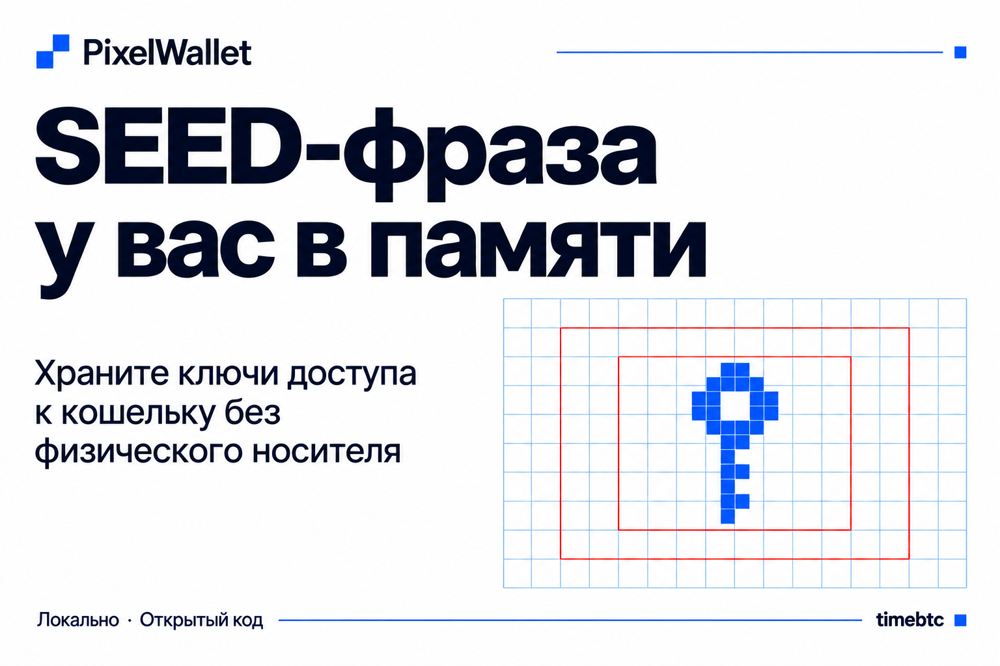

# PixelWallet



**Ключ к кошельку — у вас в памяти.**

Русский · [English](README.en.md)

PixelWallet создаёт сид-фразу BIP39 из пароля и рисунка на карте. Пароль определяет расположение слов, выбранные ячейки — их набор. Последнее слово рассчитывается автоматически.

Приложение представляет собой один HTML-файл со встроенными библиотеками и словарём. Вычисления выполняются локально в браузере.

## Трилемма сид-фразы

Сид-фраза даёт возможность восстановить ключи криптовалютного кошелька. Её хранение требует совместить три задачи:

- Не потерять доступ самому.
- Защитить данные восстановления от посторонних.
- Предусмотреть передачу доступа близким.

Эти задачи часто называют «трилеммой сид-фразы». Слишком хорошо спрятанную копию трудно найти семье. Доступную запись проще обнаружить посторонним. А список случайных слов сложно надолго удержать в памяти без ошибок.

## Как помогает PixelWallet

PixelWallet разделяет данные, из которых получается сид-фраза, на **пароль и визуальный рисунок**. Вместо запоминания последовательности случайных слов человек запоминает текст и расположение выбранных ячеек. Программа формирует слова и автоматически рассчитывает последнее слово с контрольной суммой.

Рисунок можно сохранить отдельно от пароля. В изображении нет готовой сид-фразы: чтобы получить её, нужны также пароль, длина фразы и PixelWallet с тем же алгоритмом. Так данные восстановления можно распределить между разными местами хранения.

Для близких можно заранее подготовить инструкцию и порядок получения обеих частей. Вместе с ними нужно сохранить HTML-файл приложения и длину фразы. Это позволяет спланировать передачу доступа, не оставляя всю готовую сид-фразу в одной записи.

**Данные для доступа к криптовалюте можно держать в голове — как пароль и рисунок.** Сама криптовалюта остаётся в блокчейне, а в памяти хранится способ восстановить доступ к ней.

PixelWallet помогает организовать решение трилеммы, но сохранность данных зависит от выбранного способа хранения. Забытый пароль или неточно повторённый рисунок могут привести к потере доступа, поэтому восстановление и порядок передачи близким нужно проверить заранее.

## Использование

1. Скачайте `PixelWallet.html` и откройте его в браузере с поддержкой JavaScript, WebAssembly и Web Workers.
2. Введите пароль и выберите длину фразы: 12, 18 или 24 слова.
3. Отметьте соответственно 11, 17 или 23 ячейки. Можно нажимать на отдельные ячейки или рисовать непрерывно.
4. Готовая фраза появится под картой.

Ячейки читаются сверху вниз, в каждой строке — слева направо. Порядок нажатий не влияет на порядок слов. Движение с выбранной ячейки стирает точки.

На телефоне карандаш включает рисование, ладонь — перемещение карты. Кнопки «+» и «−» меняют масштаб, кнопка с четырьмя уголками возвращает обзор всей карты.

«Скачать карту · PNG» сохраняет изображение рисунка. «Скопировать фразу» переносит слова в системный буфер обмена после подтверждения. «Сбросить» очищает рисунок, «Очистить сеанс» — пароль, карту и рисунок, возвращая длину к 12 словам.

## Восстановление

Для получения той же фразы нужны:

- точный пароль;
- тот же набор выбранных ячеек;
- та же длина фразы;
- PixelWallet с той же версией алгоритма.

Сохраните используемый HTML-файл. Проверьте восстановление в новом сеансе и сравните каждое слово. Изображение PNG служит образцом рисунка и не содержит пароль или длину фразы.

Полученную сид-фразу можно использовать в совместимом кошельке. Дополнительную passphrase и параметры восстановления кошелька, если они используются, сохраняют отдельно.

## Алгоритм

| Параметр | Значение |
|---|---|
| Карта | 64 × 32 ячейки |
| Словарь | Английский BIP39, 2048 слов |
| Подготовка пароля | Unicode NFKD → UTF-8 |
| Выработка ключа | Argon2id 1.3 |
| Публичная соль | `PixelWallet`, UTF-8 |
| Память Argon2id | 131072 КиБ |
| Проходы | 15 |
| Параллелизм | 1 |
| Длина ключа | 32 байта |

Слова перемешиваются алгоритмом Fisher–Yates с отбрасыванием значений для устранения смещения. Поток чисел строится через SHA-256 от ключа и четырёхбайтового счётчика big-endian, начиная с нуля.

Индексы выбранных ячеек сортируются по возрастанию. Индексы соответствующих слов записываются по 11 бит и дополняются справа 7, 5 или 3 нулями для фраз из 12, 18 или 24 слов. Полученные байты кодируются по BIP39 с добавлением контрольной суммы.

Формулы и контрольный пример приведены в разделе «Техническая часть» приложения. Изменение алгоритма или его параметров меняет результат восстановления.

## Безопасность

Код приложения не отправляет введённые данные на сервер и не записывает их в браузерные хранилища. Пароль, карта и фраза находятся в памяти во время работы. Очистка сеанса не гарантирует стирание всех копий из памяти браузера или ОС.

Скопированная фраза может остаться в истории системного буфера или попасть в его синхронизацию. Изображение PNG раскрывает рисунок; храните его отдельно от пароля.

Стойкость зависит от непредсказуемости пароля и рисунка. Argon2id увеличивает стоимость перебора, но не устраняет риск слабых исходных данных. Контрольная сумма BIP39 проверяет формат фразы, а не безопасность всей схемы.

Используйте доверенное устройство и проверенную копию приложения. Публикация исходного кода не является независимым аудитом безопасности.

## Зависимости

| Библиотека | Версия | Назначение |
|---|---|---|
| `hash-wasm` | 4.12.0 | Argon2id / WebAssembly |
| `@scure/bip39` | 2.0.1 | BIP39 и словарь |
| `@noble/hashes` | 2.0.1 | SHA-256 |
| `@scure/base` | 2.0.0 | Вспомогательное кодирование |

Библиотеки встроены в HTML. Их лицензионные уведомления сохранены в конце скрипта.

## Целостность файлов

`SHA256SUMS` содержит контрольные суммы приложения, обоих README, обложек и лицензии. Проверка в macOS или Linux:

```sh
shasum -a 256 -c SHA256SUMS
```

Контрольные суммы проверяют совпадение файлов с доверенной копией комплекта, но сами по себе не подтверждают безопасность программы или подлинность автора.

## Лицензия

Собственный код и документация PixelWallet предоставлены на условиях [CC0 1.0 Universal](LICENSE) в пределах прав, которыми можно распорядиться. Их можно свободно использовать, изменять и распространять, включая коммерческое использование. Упоминание автора идеи приветствуется и не является обязательным условием.

Лицензии и уведомления авторов встроенных библиотек сохраняют силу.

**Идея и концепция — [timebtc](https://github.com/timebtc).**
