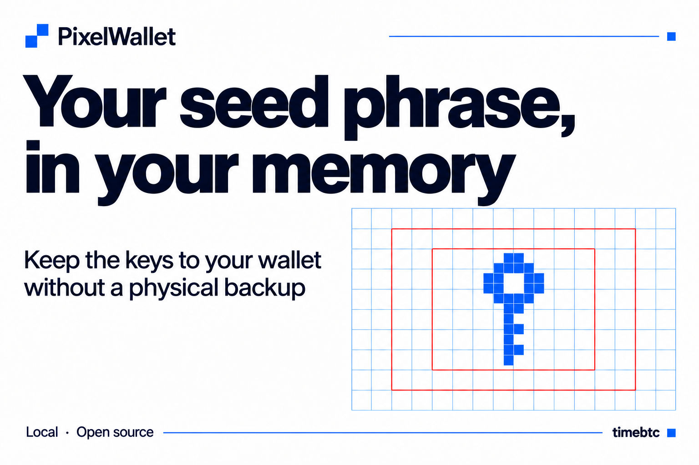

<h1 align="center">PatternSeed</h1>

<p align="center"><strong>The key to your wallet — in your memory.</strong></p>

<p align="center"><a href="https://timebtc.github.io/PatternSeed/PatternSeed.html"><strong>Try PatternSeed</strong></a> &nbsp; · &nbsp; <a href="https://github.com/timebtc/PatternSeed/raw/refs/heads/main/PatternSeed.html"><strong>Download HTML</strong></a> &nbsp; · &nbsp; <a href="README.ru.md"><strong>Русский</strong></a></p>

<p align="center">
  
  
  <a href="LICENSE"></a>
</p>



PatternSeed generates a BIP39 seed phrase from a password and a visual pattern drawn on a 64×32 grid. The password determines the word layout; the selected cells determine which words are used. All calculations run locally in a single self-contained HTML file. Once downloaded, the file works without an internet connection.

[Quick start](#quick-start) · [The idea](#the-seed-phrase-trilemma) · [Recovery](#recovery) · [Algorithm](#algorithm) · [Security](#security) · [FAQ](#faq)

---

## At a glance

| Remember and recover | Use the tool |
|---|---|
| A password and pattern instead of memorizing a word list | One self-contained HTML file |
| 12-, 18-, or 24-word phrases | English and Russian interface |
| Automatically calculated final word | Draw with a mouse or touch |
| Reproducible output from the same inputs | Download the pattern as PNG |

## Quick start

1. Download [PatternSeed.html](https://github.com/timebtc/PatternSeed/raw/refs/heads/main/PatternSeed.html) and open it in a browser that supports JavaScript, WebAssembly, and Web Workers.
2. Enter a password and choose a phrase length: 12, 18, or 24 words.
3. Select 11, 17, or 23 cells respectively. You can select individual cells or draw continuously.
4. The resulting phrase appears below the grid.

Cells are read from top to bottom, and from left to right within each row. The order in which you select cells does not affect word order. Starting a stroke on a selected cell switches that stroke to erasing.

On a phone, the pencil enables drawing and the hand enables panning. The “+” and “−” buttons adjust zoom; the four-corner button fits the entire grid into view.

Use **RU / EN** in the header to switch the interface, messages, and documentation between Russian and English. Switching languages preserves the current password, pattern, and phrase. The BIP39 word list remains English.

Main controls:

| Control | Action |
|---|---|
| Download grid · PNG | Download an image of the pattern |
| Copy phrase | Copy the phrase to the system clipboard after confirmation |
| Reset | Clear the pattern |
| Clear session | Clear the password, grid, and pattern, and reset phrase length to 12 words |

## The seed phrase trilemma

A seed phrase lets you recover the keys to a cryptocurrency wallet. Keeping it safe involves three competing goals:

- Keep access for yourself.
- Keep recovery information away from other people.
- Make access available to your family if something happens to you.

This tension is often described as the seed phrase trilemma. A carefully hidden backup may be difficult for family members to find. An accessible record may also be discovered by someone else. And a list of random words is hard to remember accurately over many years.

## How PatternSeed helps

PatternSeed separates the information used to generate a seed phrase into **a password and a visual pattern**. Instead of memorizing a sequence of random words, you remember text and the positions of selected cells. The application retrieves the words and calculates the final word, including the checksum.

You can keep the pattern separately from the password. The exported image does not contain the seed phrase itself: recovery also requires the password, phrase length, and a copy of PatternSeed using the same algorithm. This lets you distribute recovery information across separate locations.

For family members, you can prepare instructions explaining how to obtain both parts. Keep the application HTML file and phrase length with the recovery plan. This supports inheritance planning without putting the complete seed phrase in a single record.

**You can remember the information needed to access your cryptocurrency as a password and a pattern.** The cryptocurrency remains on the blockchain; what you remember is a way to recover access.

PatternSeed helps you manage the trilemma, but it does not remove the need for a recovery plan. Forgetting the password or reproducing the pattern incorrectly can cause loss of access. Test recovery and the arrangements for your family in advance.

## Recovery

To reproduce the same phrase, you need:

- the exact password;
- the same set of selected cells;
- the same phrase length;
- PatternSeed with the same algorithm version.

Keep the HTML file you use. Test recovery in a new session and compare every word. The PNG image serves as a pattern reference and does not contain the password or phrase length.

PatternSeed reproduces the phrase; a compatible wallet uses that phrase to recover keys and addresses. Keep any additional BIP39 passphrase and wallet recovery settings separately if you use them.

## Algorithm

<details>
<summary>Parameters and generation rules</summary>

| Parameter | Value |
|---|---|
| Grid | 64 × 32 cells |
| Word list | English BIP39, 2,048 words |
| Password preparation | Unicode NFKD → UTF-8 |
| Key derivation | Argon2id 1.3 |
| Public salt | 32 raw bytes; hex: `175313be2569ec3570bcca06592fe6503575d6cb40887733fb26c21f95a4e364` |
| Argon2id memory | 131,072 KiB |
| Passes | 15 |
| Parallelism | 1 |
| Key length | 32 bytes |

The fixed public salt is a SHA-256 digest used as bytes, not hexadecimal text.

Words are shuffled using Fisher–Yates with rejection sampling to avoid modulo bias. The number stream is generated using SHA-256 of the key followed by a four-byte big-endian counter, starting at zero.

Selected cell indices are sorted in ascending order. The corresponding word indices are represented as 11-bit values and padded on the right with 7, 5, or 3 zero bits for 12-, 18-, or 24-word phrases respectively. The resulting entropy bytes are encoded as a BIP39 mnemonic with its checksum.

Formulas and a test vector are provided in the application's “Technical details” section. Changing the algorithm or its parameters changes the recovery result.

</details>

## Security

The application code does not send entered data to a server or write it to browser storage. The password, grid, and phrase remain in memory during use. Clearing a session does not guarantee that every copy is erased from browser or operating system memory.

A copied phrase may remain in clipboard history or be synchronized by the operating system. A PNG image reveals the pattern; keep it separately from the password.

Security depends on how unpredictable the password and pattern are. Argon2id increases the cost of deriving each password’s grid; multiple patterns can then be checked against that grid. It cannot compensate for weak inputs. A valid BIP39 checksum checks the phrase format, not the security of the complete scheme.

Use a trusted device and a verified copy of the application. Publishing source code does not constitute an independent security audit.

## Dependencies

<details>
<summary>Bundled libraries</summary>

| Library | Version | Purpose |
|---|---|---|
| `hash-wasm` | 4.12.0 | Argon2id / WebAssembly |
| `@scure/bip39` | 2.0.1 | BIP39 and word list |
| `@noble/hashes` | 2.0.1 | SHA-256 |
| `@scure/base` | 2.0.0 | Encoding utilities |

The libraries are embedded in the HTML file. Their license notices are preserved at the end of the script.

</details>

## File integrity

`SHA256SUMS` contains checksums for the application, both README files, the cover images, and the license. To verify them on macOS or Linux:

```sh
shasum -a 256 -c SHA256SUMS
```

Checksums establish whether files match a trusted copy of the package. By themselves, they do not establish software security or author identity.

## FAQ

<details>
<summary>Do I need an internet connection?</summary>

The downloaded HTML file works offline. Opening the hosted website initially requires a connection.

</details>

<details>
<summary>What do I need for recovery?</summary>

The same password, selected cells, phrase length, and a saved HTML file using the same algorithm. See [Recovery](#recovery) for the steps.

</details>

<details>
<summary>Does switching languages change my phrase?</summary>

No. RU / EN changes only the interface and documentation. The grid, selected cells, and phrase stay the same.

</details>

## Feedback

Found a bug or want to discuss the method? [Open an issue](https://github.com/timebtc/PatternSeed/issues). Use only test data in reports and examples.

## License

PatternSeed's original code and documentation are released under [CC0 1.0 Universal](LICENSE), to the extent that the relevant rights can be waived. You may use, modify, and distribute them freely, including commercially. Credit for the idea is appreciated but is not a license requirement.

The licenses and notices of the bundled libraries remain in effect.

**Idea and concept — [timebtc](https://github.com/timebtc).**
